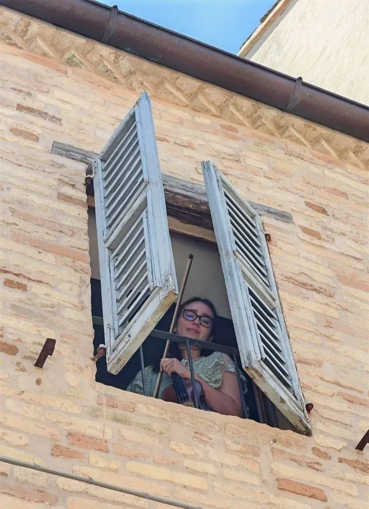

{width="720" height="992" data-color="#a79b92"}

[pianikova.com](https://pianikova.com) — сайт доступен на русском и английском языках.

Там всё обо мне: что я играю, в каких проектах участвую, о чём пишу и что меня вдохновляет. А ещё — творческая биография, краткий репертуар, пресса обо мне, анонсы и афиша.

Там же можно листать бортовой журнал «КАТАВАСИС» 😁 — если неудобно следить за постами здесь, они будут появляться и на сайте.

Заходите, буду очень рада!
🔗
 [https://pianikova.com/](https://pianikova.com/)
