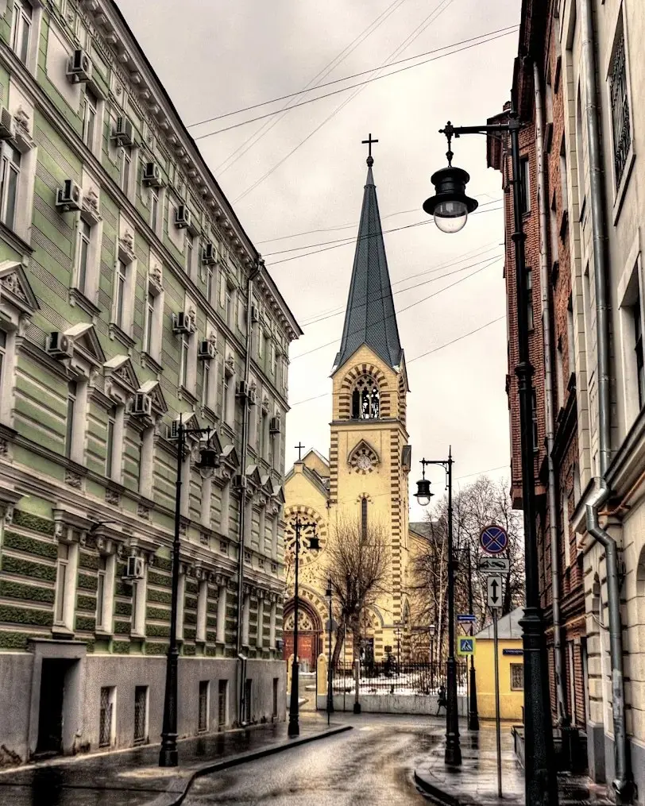
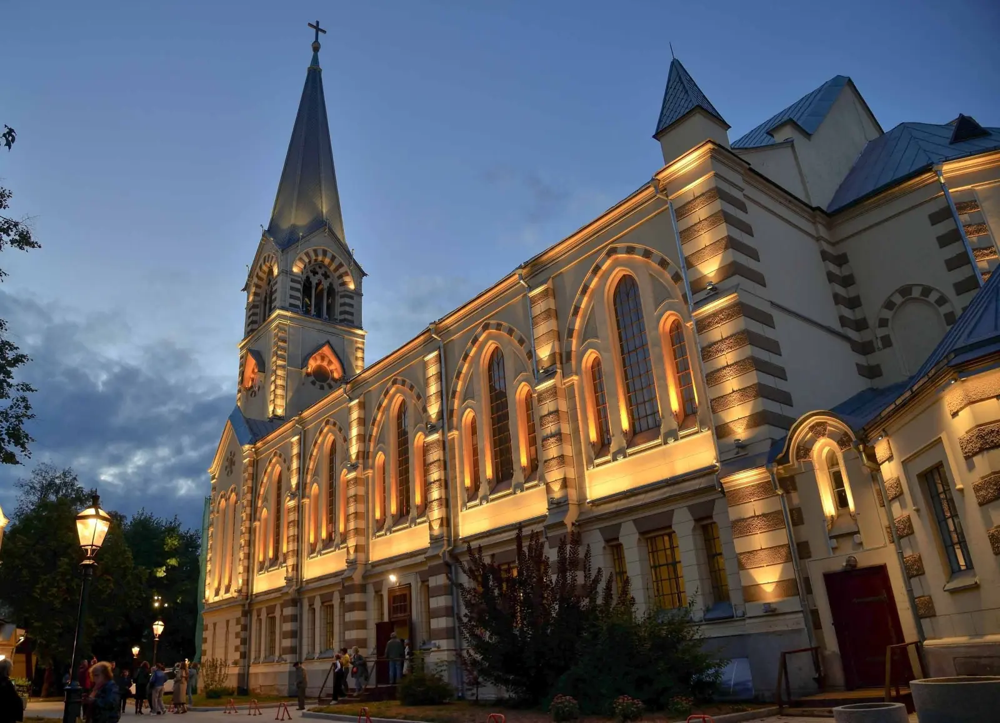
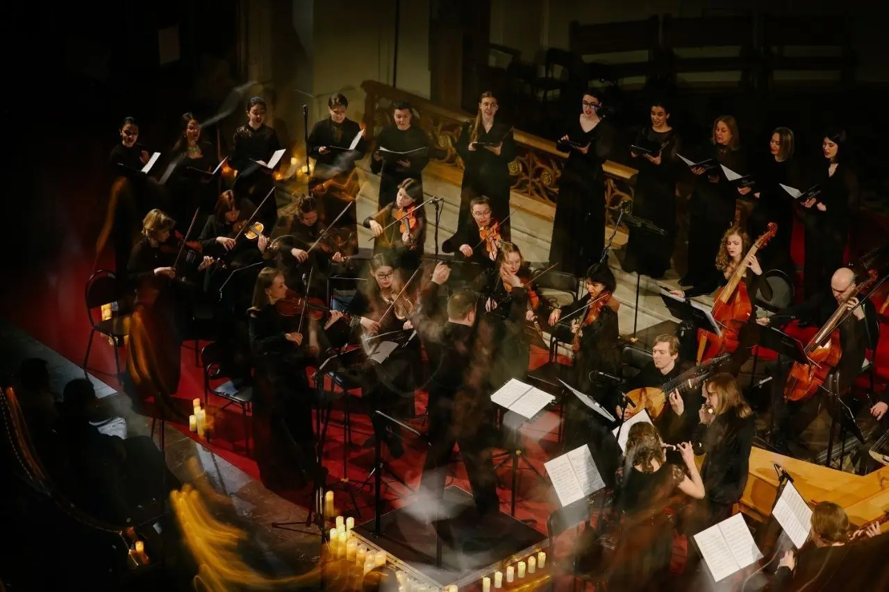
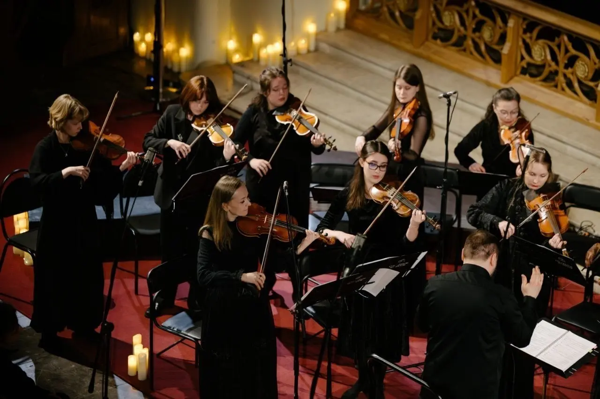
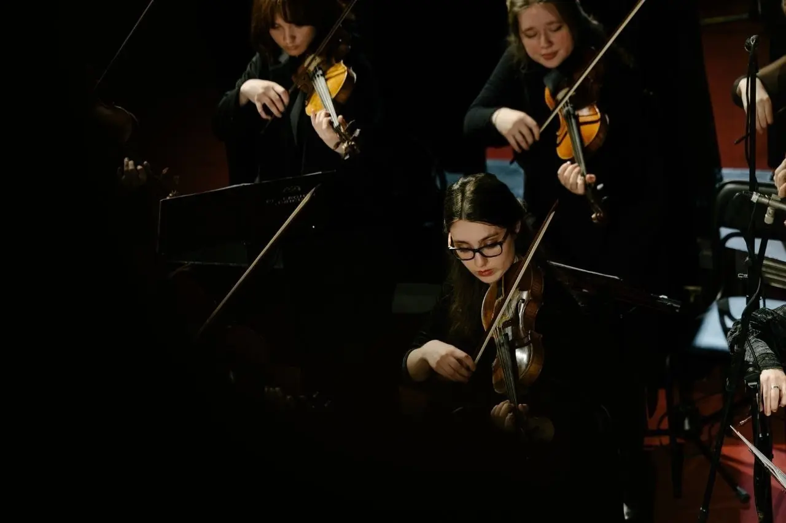
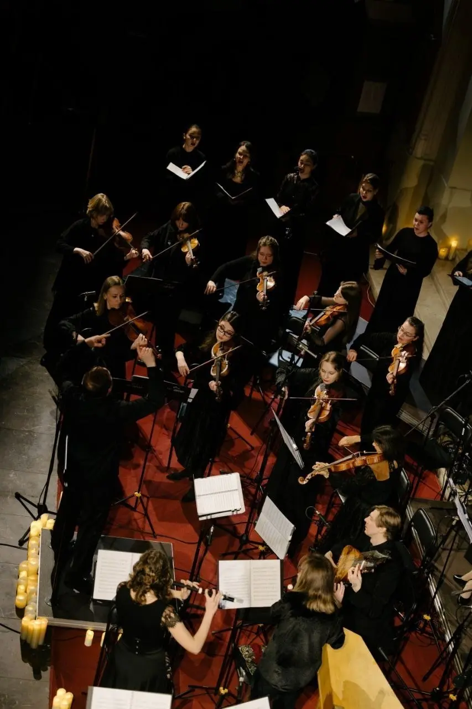
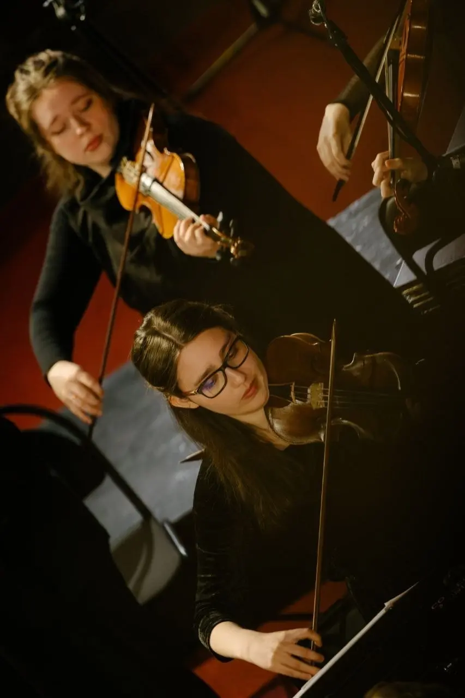
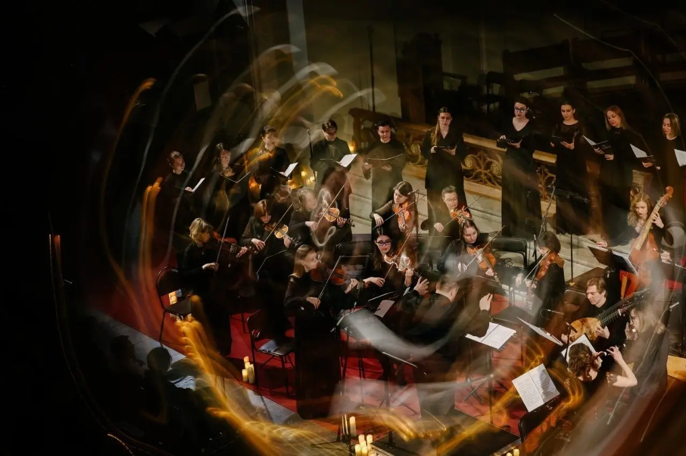

:::gallery
{width="812" height="1015" data-color="#8d8174"}

{width="1600" height="1157" data-color="#5f5b5c"}

{width="1280" height="853" data-color="#2e1d0f"}

{width="1280" height="853" data-color="#38291d"}

{width="1280" height="853" data-color="#0d0a07"}

{width="853" height="1280" data-color="#241911"}

{width="853" height="1280" data-color="#2e1e0d"}

{width="1280" height="853" data-color="#322314"}
:::

☀️☀️☀️

Ансамбль [Collegium Musicum](https://collegiummusicum.ru/) представляет Х сезон проекта «Все кантаты Баха», который носит подзаголовок **«Лейпцигские либреттисты Баха: Биркман, Хенрици».**

 Исполнение на исторических инструментах в аутентичном духе традиционно сопровождается рассказом музыковеда, кандидата искусствоведения, доцента Московской консерватории Романа Александровича Насонова.

В это воскресенье прозвучат:
**BWV 80 «Ein feste Burg ist unser Gott» —** центральная реформационная кантата Баха, чья история началась еще в Веймаре около 1715 года. Позднее, уже в Лейпциге, Бах создал на её основе грандиозную хоровую фантазию на первую строфу Лютерова хорала. Примечательно, что в кантате нет труб и литавр — вероятно, из-за политического компромисса: саксонский курфюрст был католиком, и празднование Реформации не должно было выглядеть слишком воинственно.

**BWV 149 «Man singet mit Freuden vom Sieg»** — кантата на Михайлов день (29 сентября), созданная около 1728–1729 гг. целиком на текст Пикандера. Её первый хор — перетекстовка заключительного номера «Охотничьей кантаты» BWV 208, где Бах заменил валторны на трубы и добавил партию литавр, транспонировав музыку из F-dur в D-dur. В дуэте «Seid wachsam» использован obligato фагот — необычный тембр, символизирующий, по-видимому, ночную стражу.

**BWV 19 «Es erhub sich ein Streit»** — одна из трёх сохранившихся лейпцигских кантат для Михайлова дня (1726). Её текст также связан с Пикандером. Открывающий хор с тремя трубами и литаврами живописует битву архангела Михаила с сатаной, а в теноровой арии соло трубы интонирует хорал «Herzlich lieb hab ich dich, o Herr». Кантата стала одним из первых совместных опытов Баха и Пикандера.

Успевайте на «Кантаты»! Их, конечно, больше двухсот, но и сезон уже десятый!

🎫 25 октября (воскресенье), 19:00

📍 [Кафедральный лютеранский собор Свв. Петра и Павла](https://yandex.ru/maps/org/1036790838?si=hkgv88xffz97ba3h76tajv9ey0)

**P.S. За пригласительными — в личные сообщения😁**
