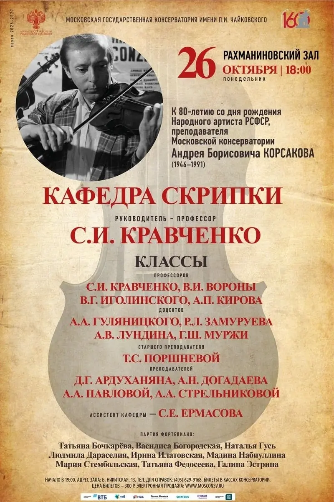
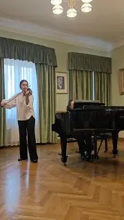

{width="800" height="1200" data-color="#c4a88a"}

**Исполню два Вальса Чайковского:**
**Вальс сентиментальный и Вальс-скерцо.**

**26 октября, понедельник**

**Начало в 18 часов!**

📍 [Рахманиновский зал Московской консерватории](https://yandex.ru/maps/org/moskovskaya_gosudarstvennaya_konservatoriya_imeni_p_i_chaykovskogo_rakhmaninovskiy_zal/38104528288?si=hkgv88xffz97ba3h76tajv9ey0)

🎫 [Билеты](https://www.mosconsv.ru/ru/concert/204113)

[{width="180" height="320" data-color="#645b4a"}](https://t.me/gattavasis/736){.video data-duration="182"}

[Уже рассказывала как-то, как проходят экзамены в консерватории](https://t.me/gattavasis/195)

Мне прислали фрагмент с кафедрального прослушивания!

Вот как всё у нас устроено: ближе к обеду второй этаж МЗК заполняется какофоническими звуками одновременной и несовместной скрипичной игры. Выстраивается огромная очередь на прослушивание в 14-й класс, где собирается вся кафедра — профессора и преподаватели. Заходим по одному, здороваемся, кланяемся, играем программу. Иногда возникают горячие обсуждения и споры. Бывает, случается конкурс на исполнение одной пьесы среди нескольких студентов, особенно популярных, вроде Вальса-скерцо.

Итак, 14-й класс — там закалялась сталь!
Прямо за спиной висят портреты Маринэ Яшвили, Майи Глезаровой… Слева от меня — памятная доска Леониду Когану. Где-то рядом — Янкелевичу.

Всегда приятно получить отклик от классных музыкантов! И это не так обезличенно, как на экзамене, с сотыми долями в оценке. Мы, например, смогли удивить редким переложением Сентиментального вальса. Обсудили, что (и как😁) я играю без моста.
