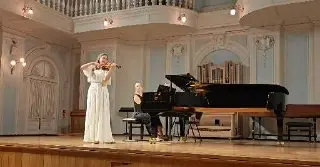

[{width="320" height="167" data-color="#79634e"}](https://t.me/gattavasis/738){.video data-duration="238"}

**Если ты, друг,**
**в «Вальсе-Скерцо»**
**Вдруг пассаж один забыл —**
**Не грусти, не рви рубаху**
**И струну ты не грызи.**

**Позови в шестёрки музу,**
**Пальцы — в бой, смычок — вперёд!**
**Пусть профессор смотрит странно:**
**Импровизация идёт!**

**Объясни ты популярно**
**Педагогу своему:**
**«Коль Чайковский**
**Квазь-каденцу**
**У ся в нотах начеркал —**
**Тварь дрожащая иль право —**
**— как прозаик завещал!»**

Учёные взялись выяснить, как эхолокация помогает летучим мышам в темноте пещеры не сталкиваться друг с другом. Так они выяснили, что они сталкиваются друг с другом. Я, собственно, к чему: искусство не лажать состоит не в том, чтобы никогда не лажать, а в том, чтобы выходить из положения изящно и сухим из воды.
🐺🐺🐺

P.S. И не играйте с температурой, заклинаю!
