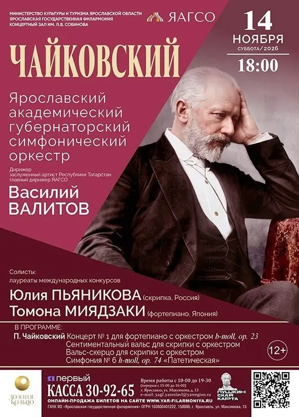
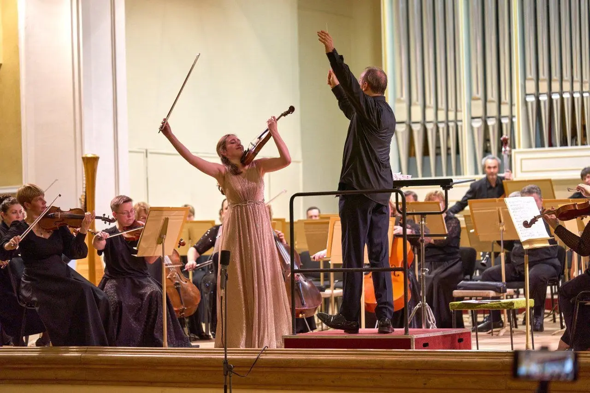

:::gallery
{width="583" height="813" data-color="#753e48"}

{width="1280" height="853" data-color="#977b67"}
:::

Выступаю с моим дорогим Ярославским академическим губернаторским симфоническим оркестром!
За дирижерским пультом — Заслуженный артист Республики Татарстан **Василий Витальевич Валитов!**

Буду в компании замечательной пианистки **Томоны Миядзаки** — она исполнит 1-й фортепианный концерт Чайковского. С Томоной мне повезло сыграть несколько концертов в Японии в этом сентябре.

[До встречи в Ярославле!](https://www.yar-filarmoniya.ru/afisha/view.php?af_id=6260)💛

📍 Концертный зал им. Л.В. Собинова.
📆14 ноября, сб

⏰Начало в 18 часов.
