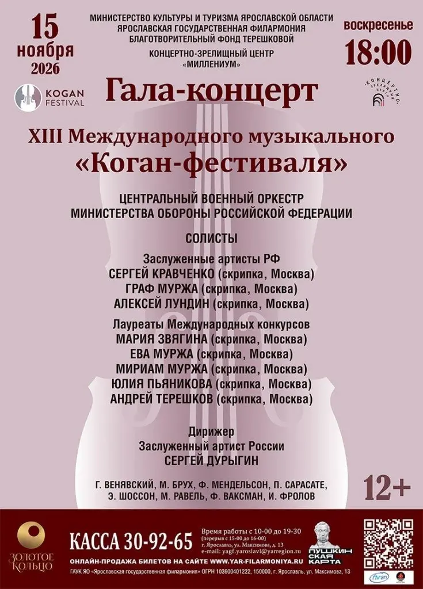
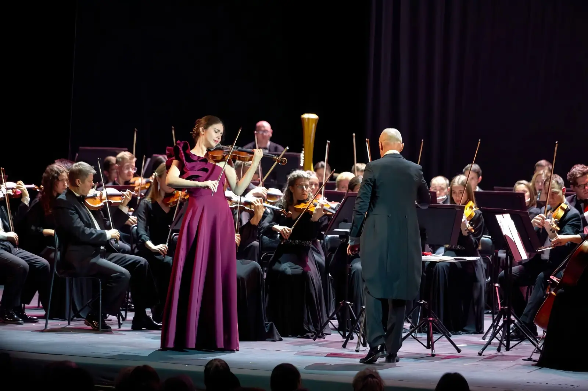

:::gallery
{width="735" height="1024" data-color="#b69ca3"}

{width="1600" height="1067" data-color="#291f24"}
:::

**Прямо сейчас еду на репетицию к воскресному Гала-концерту XIII Международного музыкального «Коган-фестиваля»!**

В прошлом году на Международном конкурсе скрипачей «Коган-Фест» я получила первую премию! И ровно год назад, **15 ноября**, также состоялся Гала-концерт в Театре им. Волкова — вот как всё было📸!

Программа обещает быть яркой и интересной! А если уж посмотреть на состав участников...🤩

Фестиваль проходит при поддержке Благотворительного фонда Терешковой, Министерства культуры и туризма Ярославской области и Ярославской государственной филармонии.

15 ноября с Центральным военным оркестром под управлением Заслуженного артиста России Сергея Юрьевича Дурыгина сыграю **Фантазию Ваксмана на темы из оперы «Кармен» Жоржа Бизе.**

И, что очень символично для фестиваля, связанного с фамилией великого скрипача **Леонида Борисовича Когана**, исполню фантазию в его версии, которую [расшифровала с его записей.](https://t.me/gattavasis/310)

[Ах, как он играет... 🎧](https://youtu.be/MEaAFxOoF8o?si=lbw1pXiMVVoNgxi8)

📍КЗЦ «Миллениум»
 📆15 ноября, воскресенье

 ⏰Начало в 18 часов.
