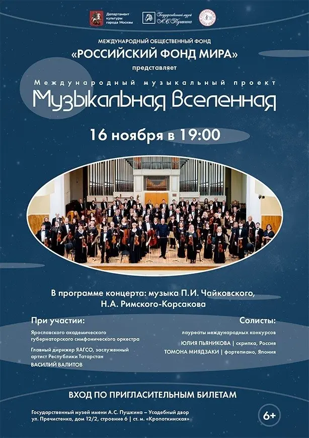
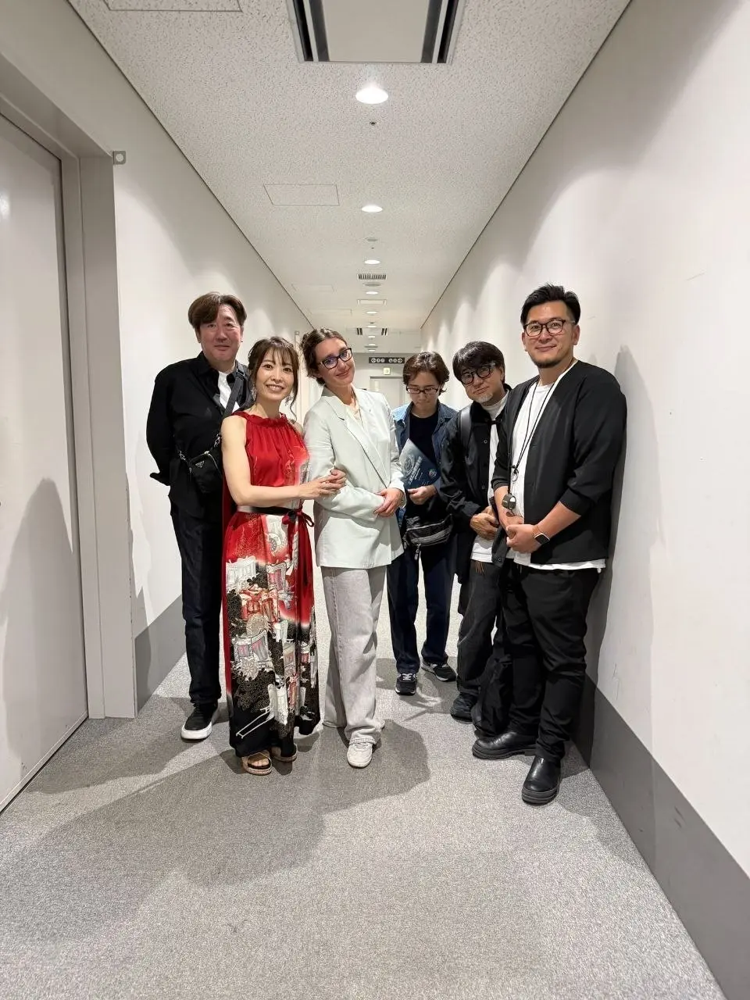
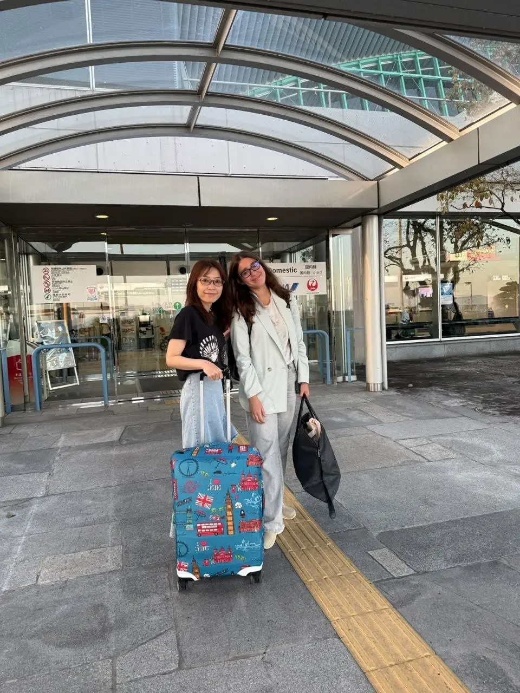

:::gallery
{width="614" height="868" data-color="#3f5466"}

{width="960" height="1280" data-color="#9c938d"}

{width="960" height="1280" data-color="#7e7e7b"}
:::

**А 16 ноября впервые сыграю в Пушкинском музее и вновь с Ярославским академическим губернаторским симфоническим оркестром!**
🤩🤩🤩

Дирижер — Заслуженный артист Республики Татарстан Василий Витальевич Валитов.

Насыщенная неделя получается, конечно.
Очень давно хотела там сыграть! Вновь выйду на сцену с дорогой талантливой пианисткой и композитором Томоной Миядзаки!!!

Концерт пройдёт в рамках Международного музыкального проекта «Музыкальная вселенная», который проводится при поддержке «Российского фонда мира».

📍Государственный музей имени Пушкина — Усадебный двор
📆 16 ноября, понедельник

⏰ Начало в 18 часов.
