[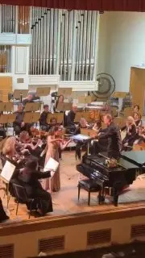{width="180" height="320" data-color="#836759"}](https://t.me/gattavasis/786){.video data-duration="98"}

С большой радостью приезжаю в Ярославль — здесь всегда встречают очень тепло! Благодарю, конечно же, не только чудесную публику Ярославской филармонии, но и артистов оркестра Ярославского академического губернаторского симфонического оркестра, художественного руководителя и главного дирижёра Василия Витальевича Валитова, директора ЯАГСО Оксану Владимировну Разживину и всех сотрудников филармонии!

А ещё через день, 16 ноября, мы с японской пианисткой и композитором Томоной Миядзаки вновь вышли вместе на одну сцену — уже в Москве, в Усадебном дворе Пушкинского музея. Скоро поделюсь❤️

Известен факт, что для Леонида Борисовича Когана ярославская сцена служила своего рода творческой лабораторией, куда он привозил свои программы перед самыми большими столичными и зарубежными концертами.

[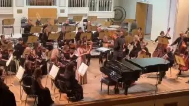{width="320" height="180" data-color="#806151"}](https://t.me/gattavasis/787){.video data-duration="70"}

:::gallery
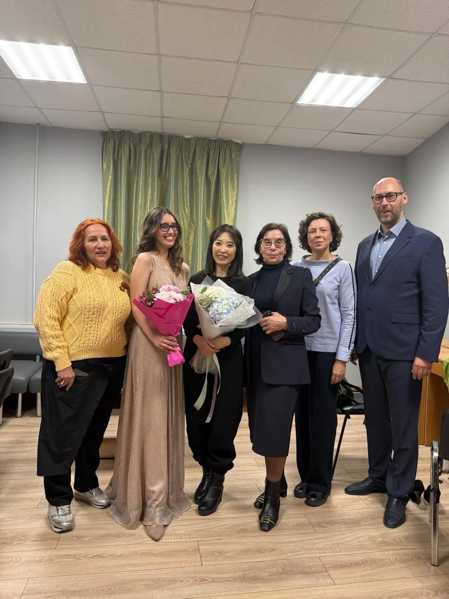{width="1200" height="1600" data-color="#7b6d62"}

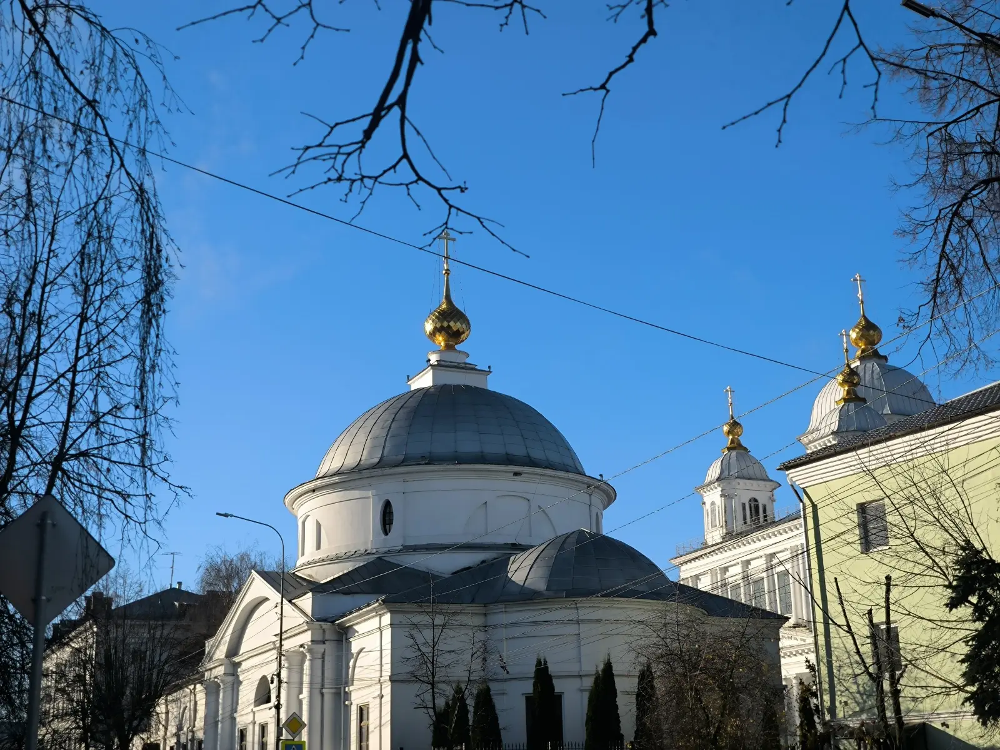{width="1600" height="1200" data-color="#4e7aa3"}

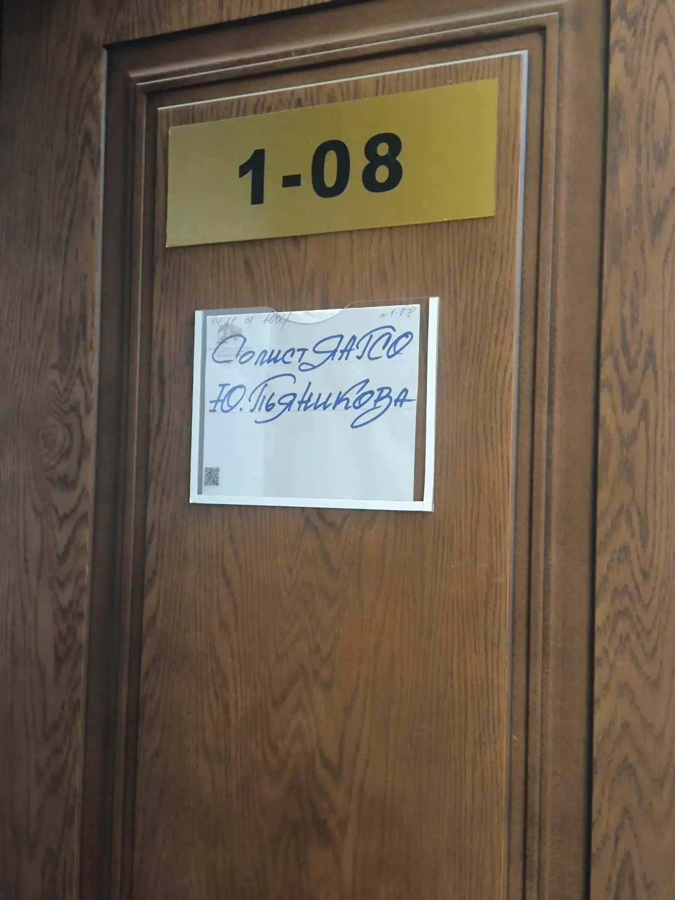{width="1200" height="1600" data-color="#6c5e4e"}

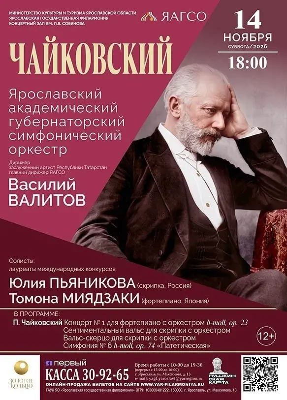{width="583" height="813" data-color="#743e48"}

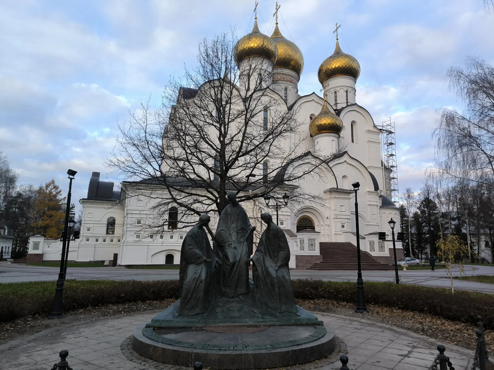{width="1600" height="1200" data-color="#767b83"}

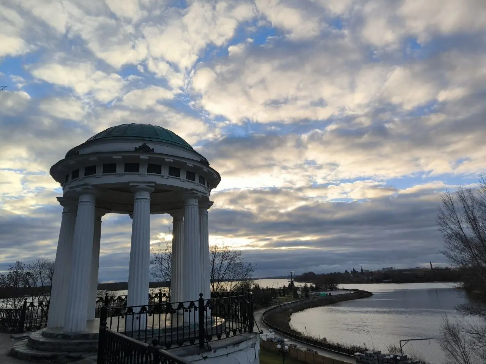{width="1280" height="960" data-color="#7f8285"}

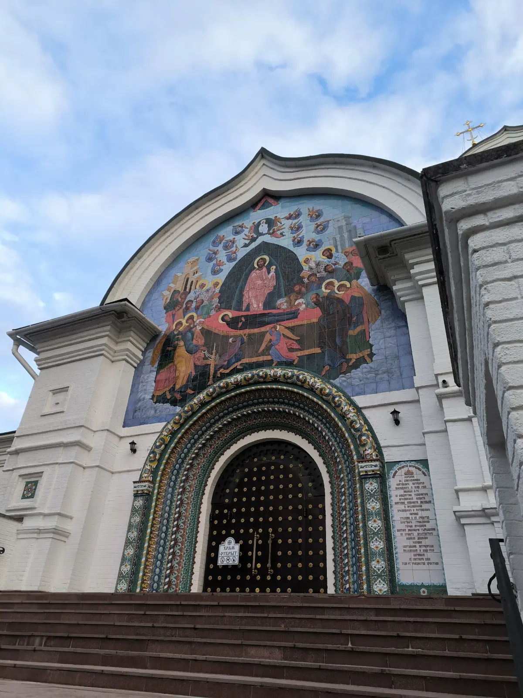{width="1200" height="1600" data-color="#767a83"}

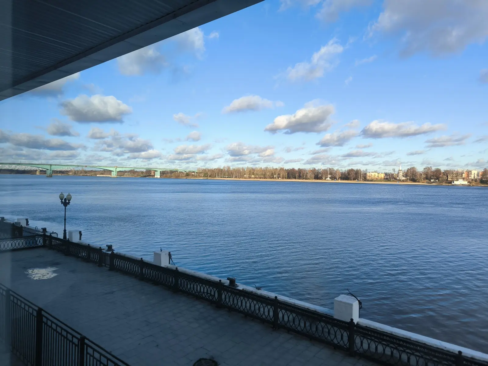{width="1600" height="1200" data-color="#6b88a3"}

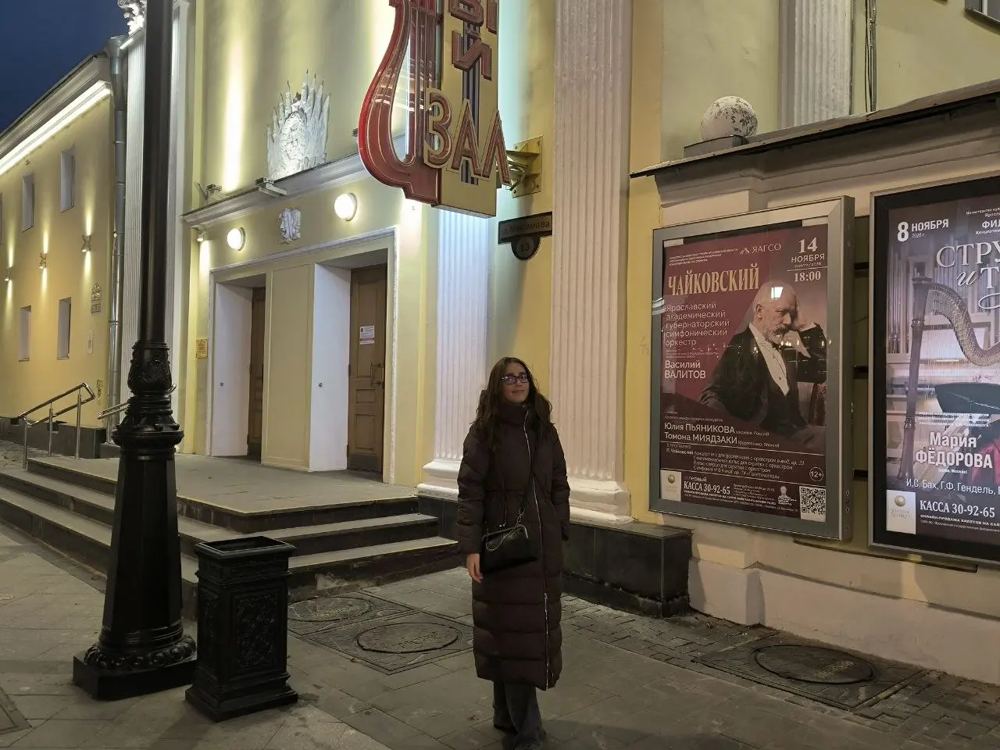{width="1280" height="960" data-color="#6f6453"}

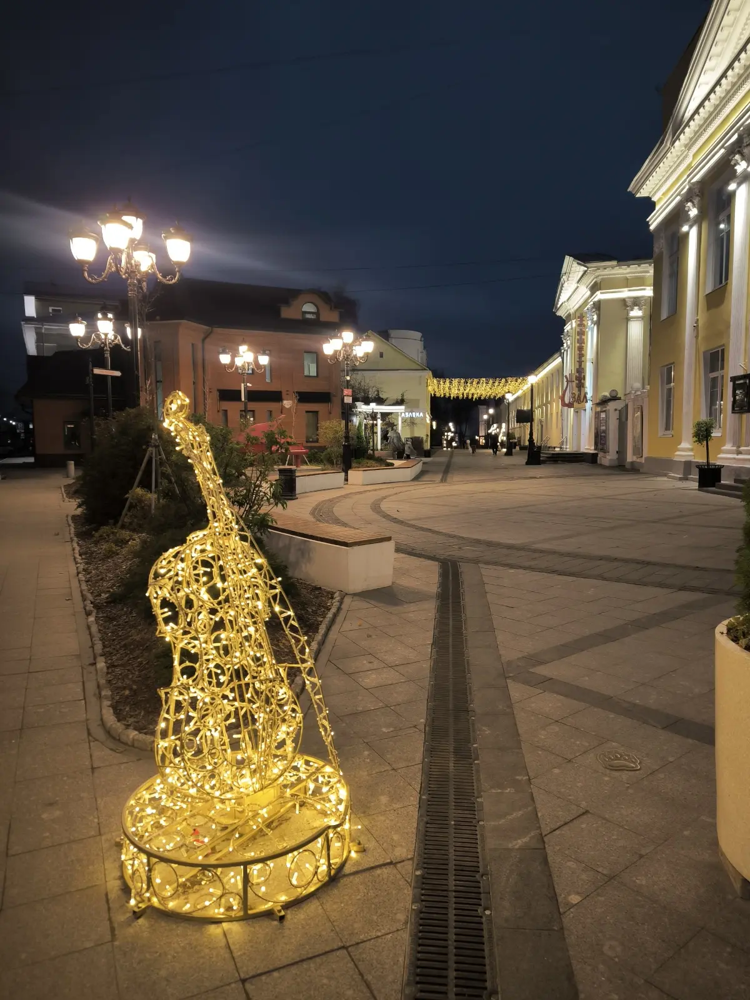{width="1200" height="1600" data-color="#5e503d"}
:::

В 1975 году именно в зале Ярославской государственной филармонии Леонид Коган впервые исполнил **Второй концерт для скрипки с оркестром Тихона Хренникова**.

По воспоминаниям современников и его внука Дмитрия Когана, Леонид Борисович очень ценил ярославскую публику и акустику зала, поэтому охотно приезжал сюда с премьерными программами.
Трагическая связь музыканта с городом закрепилась в истории в декабре 1982 года: Коган скоропостижно скончался в поезде по дороге из Москвы в Ярославль, куда ехал исполнять произведения Баха и Шостаковича.

В память об этой особой связи династии с городом внук скрипача Дмитрий Коган основал в Ярославле ежегодный Международный музыкальный «Коган-фестиваль».

**Концерт-закрытие VIII Международный музыкальный «Коган-фестиваль» состоялся на следующий день, о нём тоже скоро расскажу!**
